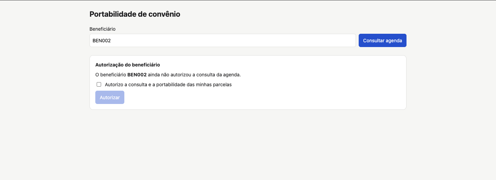
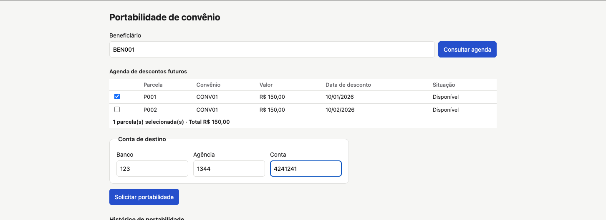
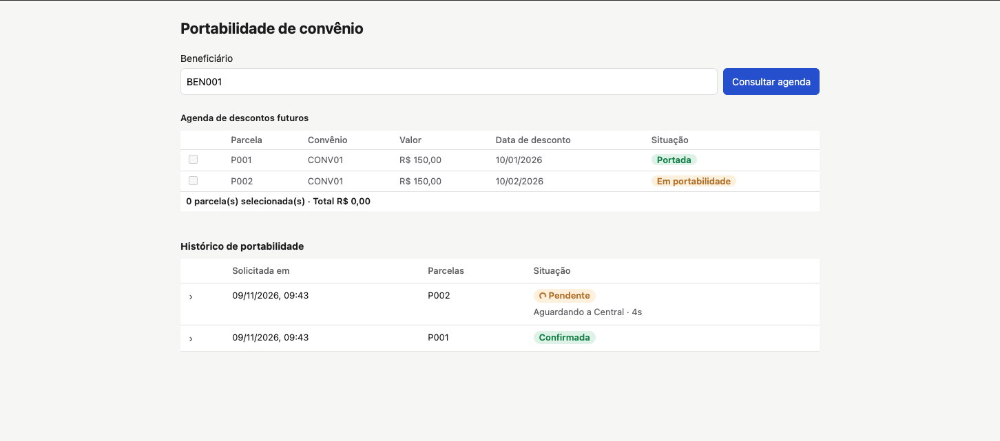
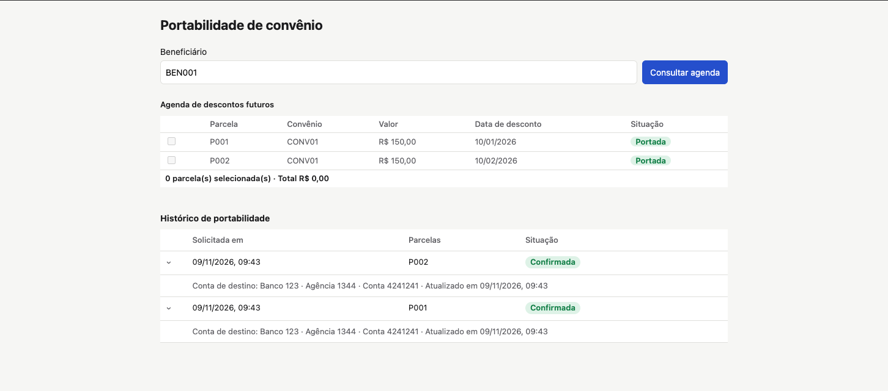
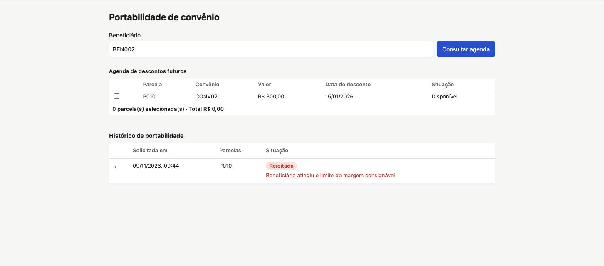
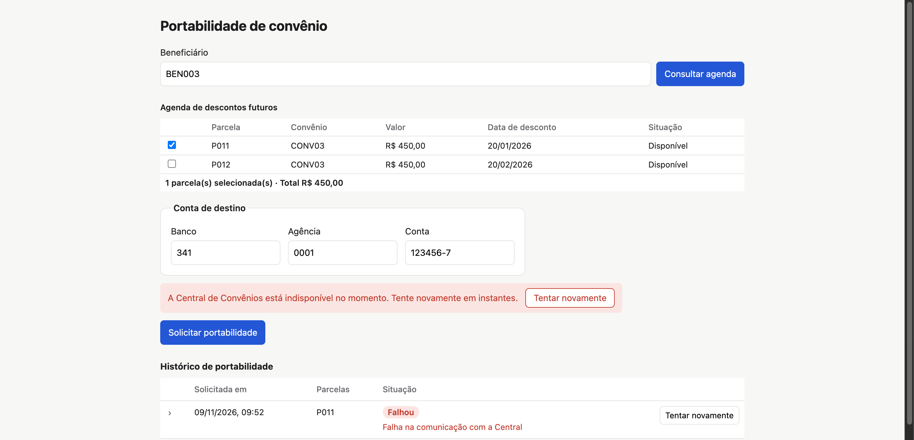

# Portabilidade de Convênios

Solução do desafio fullstack (Java + React). O operador registra o opt-in do beneficiário, vê a agenda de descontos que vem da Central de Convênios, escolhe as parcelas, informa a conta de destino e acompanha a portabilidade até a Central confirmar ou rejeitar.

- [Telas](#telas)
- [Como rodar](#como-rodar)
- [Requisitos do desafio](#requisitos-do-desafio)
- [Decisões](#decisões)
- [Bibliotecas](#bibliotecas)
- [Uso de IA](#uso-de-ia)
- [Ficou de fora e próximos passos](#ficou-de-fora-e-próximos-passos)

---

## Telas

**Opt-in.** Antes de ver a agenda, o beneficiário precisa autorizar.



**Seleção das parcelas e conta de destino** (`BEN001`). O formulário da conta só aparece depois de escolher pelo menos uma parcela.



**Acompanhamento.** A P001 já foi confirmada e a P002 está esperando a Central. Na agenda, as parcelas aparecem como "Portada" e "Em portabilidade" e não podem ser selecionadas de novo.



**Confirmada**, com o detalhe da linha aberto (conta de destino e data da última atualização).



**Rejeitada** (`BEN002`), com o motivo que a Central devolveu.



**Central fora do ar** (`BEN003`). A mensagem explica o que houve e oferece Tentar novamente. A operação que falhou já aparece no histórico e também pode ser reenviada por lá.



---

## Como rodar

| Pasta | O quê |
|---|---|
| `backend/` | API Spring Boot ([docs/API.md](backend/docs/API.md)) |
| `frontend/` | React + Vite |
| `simulator/` | Central de Convênios simulada |

### Configuração (`.env`)
Cada app tem um `.env.example`. Copie para `.env` e ajuste se precisar (o `.env` não é versionado):
```sh
cp backend/.env.example backend/.env
cp frontend/.env.example frontend/.env
```

| Arquivo | Variáveis |
|---|---|
| `backend/.env` | `SERVER_PORT`, `CENTRAL_CONVENIOS_BASE_URL`, timeouts da Central (todas opcionais) |
| `frontend/.env` | `VITE_API_URL` (obrigatória, validada em `src/config/env.ts`), `API_PROXY_TARGET` |

### Com Docker
```sh
docker compose up --build
```
O Compose lê os `.env`, se existirem, e só troca os endereços internos da rede Docker. Se alguma porta estiver ocupada: `BACKEND_PORT=18080 FRONTEND_PORT=15173 docker compose up --build`.

### Sem Docker
Precisa de Java 21, Node 22 e Yarn 1 (as versões do frontend estão fixadas com [Volta](https://volta.sh) no `package.json`) e do `frontend/.env` criado acima. Um terminal para cada:
```sh
node simulator/mock-central.js          # Central em :4000
cd backend && ./mvnw spring-boot:run    # API em :8080
cd frontend && yarn install && yarn dev # App em :5173
```

| Serviço | URL |
|---|---|
| Frontend | http://localhost:5173 |
| API | http://localhost:8080/api |
| Swagger | http://localhost:8080/swagger-ui.html |

O banco é H2 em memória, então os dados somem quando o backend reinicia.

### O que testar na tela
| beneficiarioId | O que acontece |
|---|---|
| `BEN001` | 2 parcelas. A operação fica pendente e é confirmada em uns 5s |
| `BEN002` | 1 parcela. A operação é rejeitada e o motivo aparece no histórico |
| `BEN_ERRO` | Agenda vazia. Ao enviar, aparece "Central indisponível" com o botão Tentar novamente |
| `BEN003` | Tem agenda, mas o envio dá 500 na Central. Eu adicionei esse caso no simulador |

### Testes automatizados
```sh
cd backend && ./mvnw test
cd frontend && yarn test
```

---

## Requisitos do desafio

```
Opt-in → Agenda → Seleção de parcelas + conta destino → PENDENTE → CONFIRMADA | REJEITADA
                                                          └→ FALHOU (Central recusou o envio)
```

| Requisito | | Onde está |
|---|---|---|
| RF1 Registrar opt-in | ✅ | `AuthorizationController`, componente `opt-in` |
| RF2 Consultar agenda | ✅ | `ScheduleController`, componente `schedule-table` |
| RF3 Selecionar parcelas e informar a conta | ✅ | `PortabilityOperationController`, componente `destination-account-form` |
| RF4 Acompanhar o status | ✅ | `@Scheduled` no backend + SSE na tela ([decisão 2](#2-acompanhamento-do-status)) |
| RF5 Rejeição e falha da Central | ✅ | `ApiExceptionHandler` + `error-message.ts` ([decisão 3](#3-erros-da-central)) |
| Evitar duplicidade | ✅ | Trava por parcela ([decisão 1](#1-duplicidade)) |
| Erros de integração explícitos | ✅ | `CentralConveniosHttpGateway` ([decisão 3](#3-erros-da-central)) |
| Código organizado | ✅ | ArchUnit no backend, ESLint no frontend ([decisões 4 e 5](#4-arquitetura-do-backend)) |
| Testes dos fluxos principais | ✅ | Backend: endpoints e polling. Frontend: a página inteira com MSW |
| Diferencial: HMAC | ❌ | [Ficou de fora](#ficou-de-fora-e-próximos-passos) |
| Diferencial: histórico da operação | ✅ | Data da solicitação na linha e "Atualizado em" no detalhe. A operação só muda de status uma vez, então essas duas datas cobrem tudo |
| Diferencial: testes de erro | ✅ | Central fora do ar, timeout, conexão derrubada, resposta malformada, protocolo desconhecido |
| Diferencial: UX | ✅ | [Decisão 7](#7-ux) |

---

## Decisões

### 1. Duplicidade
O que não pode duplicar é a parcela, não a requisição. Então cada parcela de uma operação ativa (pendente ou confirmada) vira uma linha na tabela `installment_locks`, com `installmentId` único no banco. Se chegar outro pedido com uma parcela que já está travada, a API responde 409 com os ids das operações envolvidas, e a tela leva o usuário para o histórico. Quando a operação é rejeitada ou falha, as travas são apagadas e as parcelas ficam livres de novo.

Como quem garante é a constraint do banco, isso funciona até com duas requisições chegando ao mesmo tempo (tem teste para isso). E de quebra impede portar a mesma parcela duas vezes com contas diferentes.

No front, o botão também fica desabilitado enquanto o envio está em andamento, mas isso é só conforto. A garantia está no backend.

### 2. Acompanhamento do status
A Central não avisa quando decide, então alguém precisa perguntar. Quem pergunta é o backend, com um `@Scheduled` que consulta as operações pendentes respeitando o `Retry-After` que a Central devolve. Quando o status muda, o backend publica um evento depois do commit e manda para a tela por SSE (Server-Sent Events). No front, o `EventSource` grava o status direto no cache do TanStack Query.

Fiz assim porque o acompanhamento continua mesmo com a tela fechada, só um lugar conversa com a Central, e a tela atualiza sozinha sem ficar fazendo polling. O SSE é de mão única (que é tudo que a tela precisa), é HTTP comum e o navegador reconecta sozinho se a conexão cair.

### 3. Erros da Central
Toda resposta da Central passa por um único método no gateway, que separa os erros em dois tipos:
- **Indisponível** (5xx, timeout, conexão derrubada): vira 503. Vale tentar de novo.
- **Resposta inválida** (corpo vazio, campo faltando, 4xx inesperado): vira 502.

A API sempre responde no formato `ProblemDetail` (RFC 9457) com um campo `code`. O front escolhe a mensagem pelo `code`, não pelo texto, e só mostra "Tentar novamente" quando faz sentido (502, 503 ou falha de rede).
Os timeouts são de 2s para conectar e 5s para ler, e dá para mudar pelo `.env`. Também tomei cuidado para não logar a mensagem das exceções, porque ela pode trazer o corpo da resposta da Central, com dados financeiros.

### 4. Arquitetura do backend
Camadas `controller → service → domain/repository`, com a Central atrás da interface `CentralConveniosGateway`. Assim cada mudança tem um lugar certo: se muda o contrato da Central, mexo em `integration`; se muda o JSON da API, em `dto`/`controller`; se muda regra de negócio, em `domain`. Os services não sabem nada de HTTP.

Para isso não se perder com o tempo, as regras viraram teste com ArchUnit (`ArchitectureTest`):
- quem pode acessar quem entre as camadas;
- services só usam a interface do gateway, nunca o `RestClient`;
- o domínio não depende do Spring (as entidades usam anotações JPA; separar entidade de domínio e de persistência ia dobrar as classes sem ganho aqui);
- sem dependência cíclica entre pacotes;
- só injeção por construtor.

Toda mudança de status passa pelo `PortabilityOperationTransitionService`, que apaga as travas quando precisa e publica o evento do SSE. São três caminhos que mudam status, e com um ponto só não tem como um deles esquecer uma dessas coisas. As entidades também têm `@Version` para não sobrescrever uma escrita concorrente sem perceber.

Nos testes, a Central é um servidor HTTP fake de verdade (`CentralConveniosStub`), não um mock. Assim consigo testar timeout e conexão derrubada como eles acontecem.

### 5. Arquitetura do frontend
Organizei por feature (`src/features/portability/`) porque deixa junto o que muda junto e escala bem: uma feature nova entra na própria pasta sem mexer nas outras. Para manter isso, as features e os componentes são criados pelo Plop (`yarn generate feature|component`), então todos nascem com a mesma estrutura e os mesmos nomes. E o ESLint barra uma feature importando de outra, mais ou menos o papel do ArchUnit no backend.

Todo estado que vem do servidor fica no TanStack Query, inclusive o que chega pelo SSE. Como a tela é praticamente guiada pelo servidor, não vi motivo para Redux ou um store global.

Os testes são de integração com MSW: testam a página como o usuário usa, com a API simulada na rede, então uma refatoração por dentro não quebra os testes.

Um ponto fraco: cada operação pendente no histórico abre um `EventSource` próprio, e no HTTP/1.1 o navegador só abre 6 conexões por domínio. Com muitas pendentes em várias abas, eu passaria para um stream só por beneficiário.

### 6. Banco de dados
Usei H2 em memória. Além de não precisar configurar nada, o banco fica com o mesmo ciclo de vida do simulador, que tem as agendas fixas no código e guarda as operações só em memória. Com um banco persistente, depois de confirmar o `BEN001` as parcelas `P001` e `P002` ficariam travadas para sempre, e eu teria que limpar o banco na mão para testar de novo. Reiniciando tudo junto, os dois lados voltam para o mesmo estado.

Em produção seria Postgres com migrations.

### 7. UX
- **Uma tela só.** Num cenário real, quem dá o opt-in é o beneficiário, em outro sistema, e a gente só consultaria se a autorização existe. Como o desafio pede uma captura simples e o simulador aceita o `POST /autorizacoes` direto, deixei o opt-in na mesma tela do resto. As partes vão aparecendo conforme o usuário avança (primeiro o opt-in, depois a agenda, a conta e o histórico), então dá para testar o fluxo inteiro sem sair da página.
- O beneficiário consultado fica na URL, então dá para recarregar a página ou mandar o link.
- O histórico mostra as operações pendentes atualizando ao vivo, com paginação de 5 em 5.
- A rejeição aparece na própria linha do histórico, com o motivo da Central.
- Uma operação que falhou pode ser reenviada pela linha do histórico.
- Os erros de validação que vêm do backend aparecem embaixo do campo certo.
- A agenda bloqueia as parcelas que já estão em outra operação e mostra o total selecionado.

### 8. Escopo
- Não tem autenticação. O operador digita o `beneficiarioId`.
- O opt-in é registrado uma vez por beneficiário, sem expiração nem revogação.
- Não dá para cancelar uma operação pendente; ela só termina pela resposta da Central.
- A conta de destino é validada só no formato (banco, agência e conta). Não confiro dígito verificador nem se a conta existe.
- Pensei para uma instância só do backend: o SSE e o polling não se coordenam entre réplicas.
- Deixei enviar o pedido quando a agenda está vazia, porque o `BEN_ERRO` do simulador não tem parcelas e só falha no envio. Sem isso, o cenário de erro não dava para testar pela tela.
- Adicionei o `BEN003` no simulador (tem agenda, mas o envio dá 500) para testar uma falha diferente do 503.

---

## Bibliotecas

### Backend
| Lib | Para quê |
|---|---|
| Spring Boot 4 (webmvc, data-jpa, validation) | API, persistência e validação dos DTOs |
| `spring-boot-starter-restclient` | Chamar a Central com o cliente HTTP do próprio Spring |
| springdoc-openapi | Swagger UI, para ver e testar a API pelo navegador |
| H2 | Banco ([decisão 6](#6-banco-de-dados)) |
| ArchUnit | Testar as regras de arquitetura ([decisão 4](#4-arquitetura-do-backend)) |

### Frontend
| Lib | Para quê |
|---|---|
| React 19 + Vite + TypeScript | Base. O TypeScript tipa o contrato da API |
| TanStack Query | Estado do servidor: cache, loading, erro e invalidação |
| React Hook Form + Zod | Formulário da conta de destino, com o mesmo schema validando e tipando |
| Vitest + Testing Library + MSW | Testes da página como o usuário usa, com a API simulada (inclusive o SSE) |
| ESLint + Prettier | Padrão de código e fronteiras entre features |
| Plop | Gerar features e componentes sempre com a mesma estrutura |

---

## Uso de IA

Usei o Claude Code em todas as etapas, mas sempre revisando antes de seguir para a próxima.

### Como trabalhei
1. **Plano.** Peguei os requisitos funcionais e não funcionais do desafio e fui fechando as dúvidas numa conversa em que a IA me fazia perguntas até o plano ficar claro.
2. **Spec.** Transformei o plano numa spec com user stories ("como operador, quero..., para...") e com as decisões de implementação e de testes.
3. **Revisão da spec.** Li e ajustei a spec antes de qualquer código.
4. **Implementação.** Uma parte de cada vez, com teste primeiro (TDD).
5. **Code review da IA.** Em dois eixos: se o código seguia os padrões do projeto e se fazia o que a spec pedia.
6. **Code review meu.** Por último eu revisava o diff e aprovava cada commit.

Esse ciclo se repetiu em três fases:
1. **APIs primeiro**, uma por requisito: opt-in, agenda, criação da operação e acompanhamento do status.
2. **Frontend**, usando só as APIs que já existiam.
3. **Ajustes finos.** Montar a tela mostrou o que faltava no backend, e aí vieram endpoints novos: a lista de operações do beneficiário para o histórico, a consulta do opt-in e a informação de qual operação está segurando cada parcela.

Para a IA seguir os padrões do projeto, escrevi um guia por app (`backend/AGENTS.md` e `frontend/AGENTS.md`). As regras mais importantes também viraram teste ou lint, então não dependem só de a IA ler o guia.

### Skills que usei
Quase todas são do [mattpocock/skills](https://github.com/mattpocock/skills). A `clean-architecture` é do [giuseppe-trisciuoglio/developer-kit](https://github.com/giuseppe-trisciuoglio/developer-kit).

| Skill | Onde usei |
|---|---|
| `grill-me` / `grilling` | No plano, para a IA me entrevistar até não sobrar decisão em aberto |
| `to-spec` | Gerar a spec com user stories a partir da conversa do plano |
| `prototype` | Testar o visual do fluxo antes de implementar (a paleta do `tokens.css` veio daí) |
| `implement` + `tdd` | Implementar cada parte com teste primeiro |
| `code-review` | Review em dois eixos: padrões do projeto e o que a spec pedia |
| `diagnosing-bugs` | Investigar os bugs mais chatos, primeiro reproduzindo num teste |
| `clean-architecture` | Referência para as camadas do backend |

---

## Ficou de fora e próximos passos

### Ficou de fora
- **HMAC na mensagem para a Central.** O simulador não valida assinatura, então só daria para fazer um lado e não teria como testar de verdade. <!-- ✍️ confirme o motivo -->
- **Recuperar operação pendente sem protocolo.** A chamada à Central acontece depois de gravar a operação. Se o backend cair bem no meio, a operação fica pendente sem protocolo. Com H2 em memória isso não acontece, mas com banco persistente precisaria de um job para resolver.

### Próximos passos
1. Postgres com Flyway, e o job de recuperação que isso exige.
2. Autenticação do operador, para saber quem fez cada operação e restringir o acesso aos dados dos beneficiários.
3. Uma tabela de eventos de status, se a operação ganhar mais estados (cancelada, expirada...). O evento `PortabilityOperationStatusChanged` já existe e serviria para alimentar essa tabela.
4. HMAC no envio à Central, combinado com o simulador.
5. Passar os dados da conta para uma modal (`<dialog>` nativo), com o resumo das parcelas escolhidas. Hoje o formulário aparece embaixo da agenda e empurra o histórico para baixo.

---

## Mais documentação
- [Contrato da API](backend/docs/API.md) e Swagger em `/swagger-ui.html`
- Guias de engenharia: [`backend/AGENTS.md`](backend/AGENTS.md) e [`frontend/AGENTS.md`](frontend/AGENTS.md)
